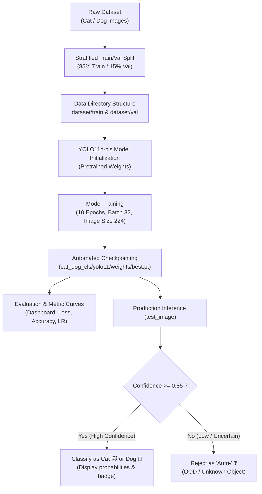

# 🐱🐶 Cat vs Dog Image Classification with YOLO11

[](https://www.python.org/)
[](https://github.com/ultralytics/ultralytics)
[](https://pytorch.org/)
[](#empirical-results--performance)
[-orange.svg)](#model-specifications)
[](LICENSE)

An end-to-end, high-performance deep learning pipeline for binary image classification (**Cat vs Dog**) powered by **Ultralytics YOLO11 Nano Classifier (`yolo11n-cls`)**.

This project covers the full machine learning lifecycle: automated dataset splitting, model fine-tuning, metric evaluation dashboards, and real-world visual inference featuring **Out-of-Distribution (OOD) rejection** with confidence thresholding.

---

## 📌 Table of Contents

- [Overview & Key Highlights](#-overview--key-highlights)
- [Notebook Organization](#-notebook-organization)
- [Architecture & Specifications](#-architecture--specifications)
- [Pipeline Workflow](#-pipeline-workflow)
- [Dataset Preparation](#-dataset-preparation)
- [Training Hyperparameters](#-training-hyperparameters)
- [Empirical Results & Performance](#-empirical-results--performance)
- [Inference & Rejection Thresholding](#-inference--rejection-thresholding)
- [Repository Structure](#-repository-structure)
- [Installation & Quickstart](#-installation--quickstart)
- [Standalone Python Usage](#-standalone-python-usage)
- [Future Enhancements](#-future-enhancements)

---

## 🌟 Overview & Key Highlights

- **State-of-the-Art Architecture**: Utilizes **YOLO11n-cls**, the latest lightweight classification backbone from Ultralytics, engineered for speed and accuracy.
- **Outstanding Accuracy**: Achieves **98.42% Top-1 validation accuracy** and **100% Top-5 accuracy** in just 10 training epochs.
- **Ultra-Lightweight & Fast**: Model contains only **~1.53M parameters** (3.2 GFLOPs), executing in **~2.2 ms per image on standard CPU**.
- **Robust Open-Set Handling**: Implements a confidence threshold mechanism ($\tau = 0.85$) to reject unrelated / non-pet images as `"Autre"` (Other/Unknown), preventing false positives.
- **Comprehensive Visual Diagnostics**: Generates high-resolution training loss curves, accuracy trajectories, learning rate dynamics, and an all-in-one summary dashboard.

---

## 📓 Notebook Organization

The project is structured into two modular, execution-ordered notebooks:

| Notebook | Purpose | Key Responsibilities |
| :--- | :--- | :--- |
| [`01_train_and_evaluate.ipynb`](01_train_and_evaluate.ipynb) | **Model Training & Evaluation** | • Stratified 85/15 dataset train/val split<br>• Fine-tunes `yolo11n-cls` over 10 epochs<br>• Evaluates validation loss and Top-1 / Top-5 metrics<br>• Plots multi-metric dashboards and standalone 300 DPI figures |
| [`02_inference_and_testing.ipynb`](02_inference_and_testing.ipynb) | **Visual Inference & Testing** | • Loads trained checkpoint (`best.pt`)<br>• Runs single-image inference (`test_image()`)<br>• Confidence thresholding ($\tau = 0.85$) for Out-of-Distribution rejection<br>• Color-coded visual badges with class probability breakdowns |

---

## 🧠 Architecture & Specifications

The classification backbone is built on the Ultralytics YOLO11 Nano architecture (`yolo11n-cls`), designed with optimized C3k2 residual blocks and depthwise convolutions.

| Attribute | Specification |
| :--- | :--- |
| **Model Variant** | `yolo11n-cls` (YOLO11 Nano Classifier) |
| **Total Layers** | 47 fused layers |
| **Total Parameters** | 1,528,586 (~1.53M parameters) |
| **Computational Complexity** | 3.2 GFLOPs |
| **Input Image Resolution** | $224 \times 224 \times 3$ (RGB) |
| **Number of Target Classes** | 2 (`Cat`, `Dog`) |
| **Output Layer** | Softmax classification head over 2 classes |
| **CPU Inference Latency** | ~2.2 – 2.4 ms / image (Intel Core i7-13650HX) |
| **Checkpoint Size** | ~3.1 MB (`best.pt`) |

---

## 🔄 Pipeline Workflow



---

## 📊 Dataset Preparation

The dataset is organized into two primary classes:
- **`Cat`**: Feline images
- **`Dog`**: Canine images

The dataset preparation module in [`01_train_and_evaluate.ipynb`](file:///01_train_and_evaluate.ipynb):
1. Reads all images across both class directories.
2. Applies `train_test_split(images, test_size=0.15, random_state=42)` for reproducible, stratified partitioning.
3. Automatically creates the standard YOLO classification directory layout:
   ```text
   dataset/
   ├── train/
   │   ├── Cat/   (~10,624 images)
   │   └── Dog/   (~10,624 images)
   └── val/
       ├── Cat/   (~1,875 images)
       └── Dog/   (~1,875 images)
   ```
4. Filters corrupted files or invalid frame formats during cache generation.

---

## ⚙️ Training Hyperparameters

The model was fine-tuned using the following configurations:

| Hyperparameter | Value | Description |
| :--- | :--- | :--- |
| **Task** | `classify` | Binary image classification |
| **Epochs** | `10` | Full training passes |
| **Batch Size** | `32` | Samples per gradient update |
| **Image Size (`imgsz`)** | `224` | Input spatial dimension ($224 \times 224$) |
| **Optimizer** | `auto` (AdamW) | Adaptive moment estimation with weight decay |
| **Initial Learning Rate (`lr0`)** | `0.01` | Base learning rate |
| **Warmup Epochs** | `3.0` | Gradual learning rate warmup |
| **Warmup Bias LR** | `0.1` | Warmup bias initialization |
| **Weight Decay** | `0.0005` | $L_2$ regularization penalty |
| **Momentum** | `0.937` | Gradient momentum factor |
| **Mixed Precision (`amp`)** | `True` | Accelerated mixed precision computation |
| **Workers** | `6 - 10` | Parallel data loading threads |

---

## 📈 Empirical Results & Performance

Across 10 training epochs, the model demonstrated rapid convergence and exceptional discriminative accuracy:

| Metric | Score / Value | Status |
| :--- | :--- | :--- |
| **Top-1 Validation Accuracy** | **98.42%** | 🏆 Best Model (`best.pt`) |
| **Top-5 Validation Accuracy** | **100.00%** | Ceiling reached |
| **Validation Loss** | **~0.046** | Low cross-entropy error |
| **Inference Time (CPU)** | **2.2 ms / image** | Real-time capable |
| **Training Duration** | **~0.8 – 1.1 hours** | On standard CPU workstation |

### Generated Diagnostic Artifacts

[`01_train_and_evaluate.ipynb`](file:///01_train_and_evaluate.ipynb) exports the following high-resolution figures:
- `training_dashboard.png`: 6-panel summary dashboard (Loss, Top-1 Acc, Top-5 Acc, LR, Loss vs Acc, Text summary).
- `loss_curve.png`: Side-by-side comparison of training loss vs validation loss.
- `top1_accuracy.png`: Epoch-wise progression of Top-1 classification accuracy.
- `top5_accuracy.png`: Top-5 accuracy progression curve.
- `learning_rate.png`: Log-scale learning rate schedule across parameter groups (`pg0`, `pg1`, `pg2`).
- `time_per_epoch.png`: Training duration per epoch.
- `accuracy_vs_loss.png`: Dual-metric comparison showcasing inverse convergence.

---

## 🎯 Inference & Rejection Thresholding

In standard binary classification, passing an unrelated image (e.g., a car, shoe, or person) forces the model to choose either "Cat" or "Dog". 

To solve this, [`02_inference_and_testing.ipynb`](file:///02_inference_and_testing.ipynb) implements an **Out-of-Distribution rejection policy**:

$$\text{Decision}(x) = \begin{cases} 
\text{"Chat"} & \text{if } \text{class} = 0 \text{ and } \text{confidence} \ge 0.85 \\
\text{"Chien"} & \text{if } \text{class} = 1 \text{ and } \text{confidence} \ge 0.85 \\
\text{"Autre"} & \text{if } \text{confidence} < 0.85 
\end{cases}$$

### Visual Prediction Badges

- 🐱 **Chat (Cat)**: Displayed with a green badge (`#27AE60`), showing top confidence score and Cat vs Dog probability distribution.
- 🐶 **Chien (Dog)**: Displayed with a blue badge (`#3498DB`), showing top confidence score and Cat vs Dog probability distribution.
- ❓ **Autre (Other / Unknown)**: Displayed with an orange badge (`#E67E22`), explicitly withholding high-confidence pet labels and flagging the input as uncertain or out-of-distribution.

---

## 📁 Repository Structure

```text
projet_CFN/
├── 01_train_and_evaluate.ipynb      # Main training, evaluation & metrics dashboard
├── 02_inference_and_testing.ipynb    # Inference testing with confidence thresholding
├── requirements.txt                 # Project Python dependencies
├── .gitignore                       # Git ignore rules for datasets, cache, and weights
└── README.md                        # Project documentation (this file)
```

*Generated directories during execution:*
- `cat_dog_cls/yolo11/weights/best.pt`: Optimized model weights checkpoint.
- `cat_dog_cls/yolo11/results.csv`: Per-epoch metrics history.
- `cat_dog_cls/yolo11/*.png`: Exported high-resolution plots and dashboard.

---

## 🚀 Installation & Quickstart

### 1. Clone the Repository
```bash
git clone https://github.com/aziz-belloumi/projet_CFN.git
cd projet_CFN
```

### 2. Set Up a Virtual Environment (Recommended)
```bash
# Create virtual environment
python -m venv venv

# Activate virtual environment
# On Windows:
venv\Scripts\activate
# On Linux/macOS:
source venv/bin/activate
```

### 3. Install Dependencies
```bash
pip install --upgrade pip
pip install -r requirements.txt
```

### 4. Run the Notebooks

Launch Jupyter Notebook or JupyterLab:
```bash
jupyter notebook
```

- Run **[`01_train_and_evaluate.ipynb`](file:///01_train_and_evaluate.ipynb)** to prepare data, train the YOLO11 model, and generate evaluation plots.
- Run **[`02_inference_and_testing.ipynb`](file:///02_inference_and_testing.ipynb)** to test the trained model on sample images with visual overlays.

---

## 💻 Standalone Python Usage

You can also use the inference function directly in your Python code:

```python
from ultralytics import YOLO
from PIL import Image
import matplotlib.pyplot as plt

def predict_pet(image_path, model_path='cat_dog_cls/yolo11/weights/best.pt', threshold=0.85):
    # Load model
    model = YOLO(model_path)
    
    # Predict
    results = model.predict(image_path, verbose=False)[0]
    top_class = results.probs.top1         # 0 = Cat, 1 = Dog
    confidence = results.probs.top1conf.item()
    
    if confidence >= threshold:
        label = "Chat (Cat)" if top_class == 0 else "Chien (Dog)"
    else:
        label = "Autre (Other / Uncertain)"
        
    print(f"Result: {label} | Confidence: {confidence*100:.2f}%")
    return label

# Example usage:
# predict_pet("test_cat.jpg")
```

---

## 🔮 Future Enhancements

- [ ] **Web Interface**: Deploy a lightweight interactive demo using Streamlit or Gradio.
- [ ] **Edge Deployment**: Export model to **ONNX** and **TensorRT / OpenVINO** for embedded deployment on edge devices (Raspberry Pi, Jetson Nano).
- [ ] **Multi-Class Expansion**: Extend classification to recognize specific dog and cat breeds or wider animal categories.
- [ ] **Data Augmentation**: Incorporate MixUp, CutMix, and Albumentations to further enhance generalization.

---

## 📄 License

This project is licensed under the MIT License. Feel free to use, modify, and distribute it for personal and educational purposes.
